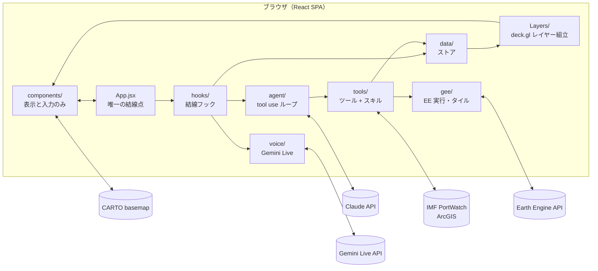
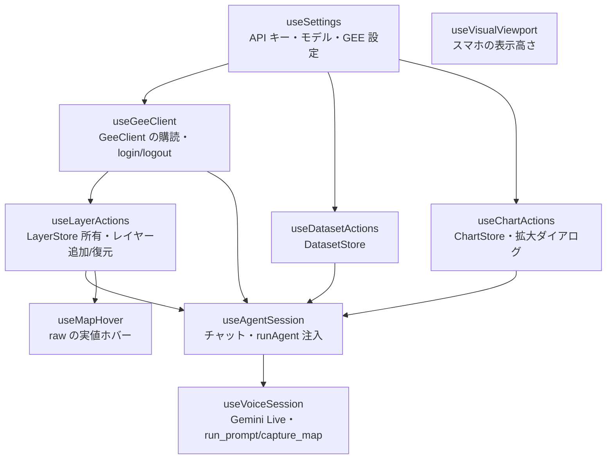
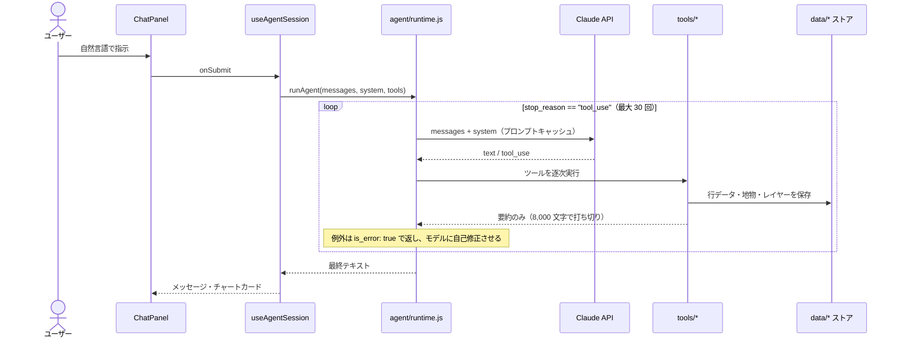
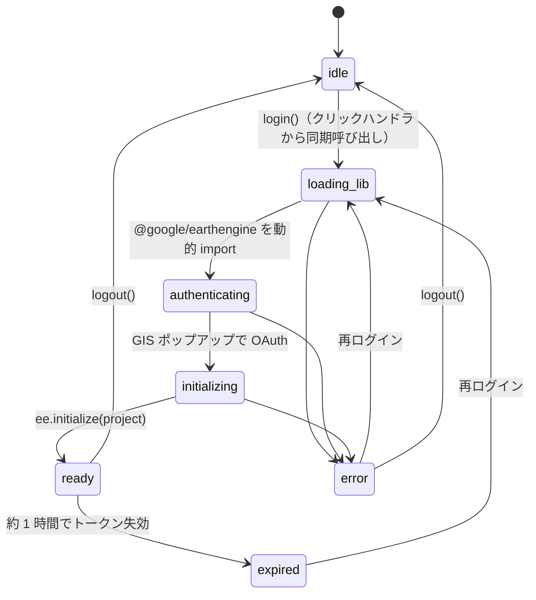
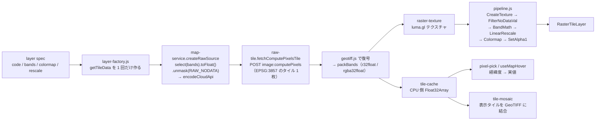
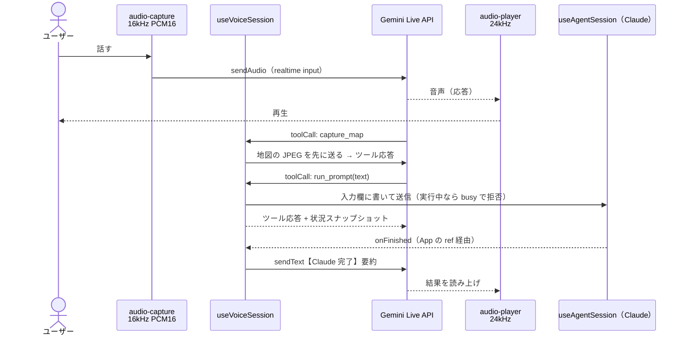

# アーキテクチャ

gee-ai-agent は**バックエンドを持たないブラウザ完結型**の分析エージェントです。Claude API・Google Earth Engine（EE）・
IMF PortWatch（ArcGIS）・Gemini Live API をすべてブラウザから直接呼びます。API キーと OAuth クライアント ID は
画面で入力し、`localStorage`（`gee-agent.*`）に保存します。

この文書は全体像と主要な処理の流れを説明します。ファイル単位の要点と「守るべき前提」は `CLAUDE.md` を参照してください。

---

## 1. 全体構成



### レイヤ分離（最重要の原則）

| ディレクトリ | 責務 | 置かないもの |
|---|---|---|
| `src/components/` | 表示と入力のみ。props で受けて描くだけ | API 呼び出し・EE コード・ストア操作 |
| `src/App.jsx` | 唯一の結線点。フックを依存順に組み立て、コンポーネントへ props を配る | ドメインロジック |
| `src/hooks/` | React とプレーン JS の橋渡し（ストアの所有・購読・注入） | 純ロジック（下位層へ） |
| `src/agent/` | Claude との tool use ループ・会話管理・システムプロンプト | EE やデータソース固有の処理 |
| `src/tools/` | エージェントに渡すツール群とスキル（拡張ポイント） | UI |
| `src/gee/` | EE の認証・コード実行・タイル配信・エクスポート | UI |
| `src/data/` | ストア（レイヤー・データセット・チャート・設定）と永続化 | ネットワーク |
| `src/voice/` | Gemini Live（音声）の接続・マイク・再生 | アプリのツール |
| `src/Layers/` | deck.gl レイヤー配列を組む唯一の場所 | データ取得 |

`agent/`・`tools/`・`gee/`・`data/`・`voice/` のうち、ブラウザ API（DOM / WebGL / EE ライブラリ）に触れない純ロジックは
`node --test` で単体テストしています。描画・認証・音声は `npm run dev` での手動確認で担保します。

---

## 2. 結線フック（`src/hooks/`）

`App.jsx` は次の順でフックを組み立てます（後ろのフックが前のフックの戻り値に依存します）。



- `useAgentSession` が `runAgent` に `callClaude`・ツールレジストリ・system を注入します。
- `useVoiceSession` の `run_prompt` は App 経由で `useAgentSession` の送信処理を呼び、Claude の完了は
  `onFinished` → App の ref → `notifyAgentFinished` の順で音声側へ戻ります。

---

## 3. エージェントの処理の流れ



### 要点
- **ツールは要約だけを LLM に返す。** 行データは `DatasetStore`（要約は localStorage、行は IndexedDB）、地物とラスターは
  `LayerStore` に置き、会話には `datasetId` / `layerId` だけを載せます。
- **コンパクション**（`compaction.js`）: 直近 8 メッセージより古い `tool_result` の本文をプレースホルダへ置き換えます。
  `tool_use` と `tool_result` の対応は保つので会話の整合性は崩れません。
- **反復上限**（既定 30 回）に達すると、ツールなしでまとめを書かせて終了します。
- **リトライ**（`claude-client.js`）: 429 / 500 / 529 は指数バックオフで最大 3 回再試行します。

### システムプロンプトの構成

```
┌─────────────────────────────────────────────┐
│ 安定プレフィックス（cache_control 付き）        │  system-prompt.js
│   BASE_SYSTEM_PROMPT                         │
│   + 各ソースのスキル（Markdown・決定的）        │  agent/skills/*.js
├─────────────────────────────────────────────┤
│ 揮発ブロック（毎ターン生成）                    │  system-context.js
│   現在日時 / GEE 状態 / レイヤー一覧            │
│   / データセット一覧 / 地図の表示範囲            │
└─────────────────────────────────────────────┘
```

プロンプトキャッシュは前方一致で効くため、**スキル文字列に現在月などの揮発情報を入れません。**

---

## 4. ツール層（拡張ポイント）

各データソースは `src/tools/<source>/index.js` で次の形を export し、`src/tools/sources.js` の `SOURCES` に 1 行足すだけで
ツール登録とシステムプロンプトの両方に反映されます。

```js
export const xxxSource = {
  id: 'xxx',
  skills: [/* Markdown 文字列（agent/skills/xxx.js） */],
  register(registry, deps) { /* registry.register(definition, handler) */ },
}
```

| ソース | 主なツール | 備考 |
|---|---|---|
| `gee` | `ee_run` / `ee_add_layer` / `ee_time_series` / `ee_describe` | `geeClient.assertReady()` 必須 |
| `map` | `list_layers` / `remove_layer` / `update_layer_style` / `get_map_view` / `fit_bounds` / `add_vector_layer` / `export_layer` | |
| `chart` | `show_chart` / `list_datasets` / `inspect_dataset` / `analyze_dataset` | |
| `portwatch` | `portwatch_search_locations` / `portwatch_fetch_metrics` / `portwatch_fetch_spillovers` / `portwatch_find_disruptions` / `portwatch_show_locations` | GEE ログイン不要 |
| `coffee` | `coffee_list_monitors` / `coffee_show_regions` | 純データ（calendar / regions / risk-profiles）が単一情報源 |

各ソースのファイル構成は `definitions.js`（ツールのスキーマ）/ `handlers.js`（実装）/ `index.js`（登録）です。
ハンドラが受け取る `deps` の形は `src/tools/register-tools.js` 先頭のコメントにあります。

ドメイン知識を足すときは「**純データ（JS モジュール）→ スキルの表を生成 + 小さなツール**」の形にします（`tools/coffee/` が雛形）。

---

## 5. GEE 層（`src/gee/`）

### 認証・初期化



接続に失敗すると `ee-diagnostics.js` が CSP 違反の記録・`connect-src` の解析・素の fetch による到達プローブを行い、
原因を日本語で説明します（DevTools から `window.__geeDiagnose()` でも実行できます）。

### コード実行（`code-runner.js`）
エージェントが書いた EE JavaScript を Code Editor と同じ形で `new Function('ee', 'ctx', code)` として実行します。
認証の書き換え・ストレージ・DOM・`fetch`・`eval` などはブラックリストで拒否し、タイムアウトを設けます。
戻り値が ee オブジェクトなら `evaluate` してから返します。実行は利用者自身のブラウザ・自身の資格情報で行われます。

### レイヤーの 2 つのモード

| | png モード | raw モード |
|---|---|---|
| 可視化 | EE 側（`applyVisualization` + `getMapId`） | ブラウザの GPU（deck.gl-raster） |
| タイル | 8bit PNG（maps エンドポイント） | float32 GeoTIFF（`image:computePixels`） |
| 描画 | `TileLayer` + `BitmapLayer` | `RasterTileLayer` |
| ホバーで実値 | × | ○（CPU 側キャッシュから参照） |
| 色・レンジの変更 | 再リクエストが必要 | 即時（再フェッチなし） |

### raw タイルの流れ



- maps エンドポイントは `format: 'GEO_TIFF'` でも可視化済みの 8bit を返すため、raw タイルは必ず `computePixels` で取ります。
- マスク画素は `RAW_NODATA`（-999999）で埋め、GPU では `FilterNoDataVal` で捨て、ホバーでは「なし」と表示します。
- `getTileData` の参照が変わると全タイルを取り直すため、`layer-factory` で 1 回だけ作り、spec の変更は `layerStore.updateSpec` で行います。
- 新規追加時は `computeViewStats` で表示範囲の統計を取り、空レイヤーを検出してエラーにし、rescale 未指定なら自動設定します。

### エクスポート
- **EE からダウンロード**（`export-service.js`）: `getDownloadURL` / `getThumbURL`。1 リクエスト約 48MB の上限を事前に推定し、
  超えそうなら実行せず `suggestedScale` を返します。
- **表示タイルから**（`tile-mosaic.js`）: raw のみ。表示中のタイル（最大 64 枚）をクライアントで結合し、
  EPSG:3857 の float32 GeoTIFF として書き出します。

---

## 6. データ層（`src/data/`）

| ストア | 保持するもの | 永続化先 |
|---|---|---|
| `LayerStore` | レイヤーの spec と描画ランタイム | spec のみ localStorage（ランタイムは GEE ready 後に `layer-factory` で再作成） |
| `DatasetStore` | 表形式の行データ | 要約は localStorage、行は IndexedDB |
| `ChartStore` | `show_chart` のチャート定義 | localStorage |
| `ConversationStore` | 会話履歴 | localStorage |
| `settings` | API キー・モデル・GEE 設定・音声設定 | localStorage |

「新しい会話」で会話・レイヤー・データセット・チャート・ログをすべて消去します。

---

## 7. 音声層（`src/voice/`）— Gemini Live

Claude とは別系統の第 2 の LLM 経路です。Gemini はユーザーと音声で会話して **Claude への指示文を作るだけ**で、
アプリのツール（GEE / PortWatch / 地図）は渡しません。渡す関数は `run_prompt` と `capture_map` の 2 つだけです。



- **ミュート**: `toggleMute` はセッションを切らずにマイク送信だけを止めます（`track.enabled = false` + チャンク破棄、
  ミュート時に `audioStreamEnd`）。Gemini の発話・ツール呼び出し・完了通知は続きます。
- AudioWorklet（`pcm-worklet.js`）は CSP の都合で同一オリジンの実ファイルとして読み込みます（blob: / data: は不可）。
- Google 検索グラウンディングは設定で切り替えます（既定 OFF）。数値の根拠は常に Claude の結果です。

---

## 8. 描画（`src/Layers/index.js` / `src/components/MapView.jsx`）

- ベースマップは MapLibre（react-map-gl）で、CARTO の dark-matter スタイルを使います。
- deck.gl は `MapboxOverlay` の **interleaved モード**で重ね、最初の symbol レイヤーの `beforeId` の下に敷きます
  （ラスターが地名ラベルの下に入ります）。
- `Layers/index.js` が LayerStore の内容から deck.gl レイヤー配列を組む唯一の場所です。
  raw は `updateTriggers.renderTile` に colormap / rescale などを入れ、再フェッチせずに再描画します。
- vector は `GeoJsonLayer`（`style.color` / `radius` / `lineWidth` / `fillAlpha`）です。
- 地図のスクリーンショット（`capture_map`）のため `<Map preserveDrawingBuffer>` を有効にしています。

---

## 9. セキュリティと信頼モデル

- **鍵は利用者のブラウザにだけ置く。** Claude / Gemini の API キーと GEE の OAuth トークンはサーバーを経由しません。
  Claude API は `anthropic-dangerous-direct-browser-access` ヘッダで直接呼びます。
- **EE コードの実行**は Code Editor と同じ信頼モデルです。利用者自身の資格情報で、利用者のブラウザ内で実行します。
  ブラックリストは誤用を防ぐための簡易的なもので、サンドボックスではありません。
- **CSP**（`vite.config.js` が本番ビルドに meta で注入）
  - `script-src` に `'unsafe-eval'` が必須（`new Function` のため）。
  - `connect-src` に Claude / EE（`earthengine.googleapis.com` と `content-earthengine.googleapis.com` の両方）/ PortWatch /
    Gemini（https と wss）を列挙します。外部ホストを増やしたら connect-src / img-src も更新します。
  - dev サーバーでは CSP を適用しないため、CSP 起因の不具合は本番ビルドでしか再現しません。

---

## 10. ビルドとデプロイ

| コマンド | 内容 |
|---|---|
| `npm run dev` | Vite 開発サーバー（http://localhost:5173） |
| `npm run build` | 本番ビルド（`dist/`）。CSP meta を注入 |
| `npm run deploy` | build のあと `gh-pages -d dist` で GitHub Pages に公開 |
| `npm run lint` | ESLint（警告 0 必須） |
| `npm test` | `node --test`（純ロジックのみ） |

- 本番ビルドは**変数名の短縮（mangle）を無効**にしています。EE は `fn.toString()` から引数名を読んで位置引数を名前付き引数へ
  対応させるため、mangle すると本番だけ全 EE ツールが壊れます。`eeParamNamesGuard` プラグインがビルド時に検査します。
- `@developmentseed/deck.gl-raster` は 0.8.0-beta.2 に固定しています。依存箇所は `Layers/index.js`・`gee/pipeline.js`・
  `gee/tms.js` に閉じ込めています。

---

## 11. 参考資料（`reference/`）

lint / test の対象外で、import は禁止です。

| ディレクトリ / ファイル | 内容 |
|---|---|
| `web-gis-ai-agent` | エージェントのコアと UI の流用元 |
| `portwatch-dashboard` | PortWatch クライアントと `docs/portwatch-api.md` |
| `deck.gl-raster` | ライブラリのソースと examples |
| `coffee.md` | コーヒー生産リスク監視の手順書の原典（`tools/coffee/` と `skills/coffee.js` に蒸留済み） |
