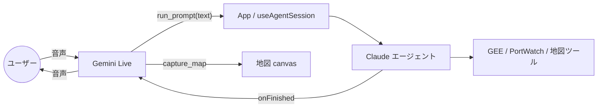
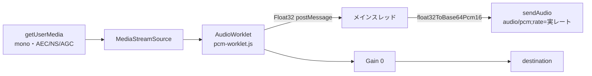
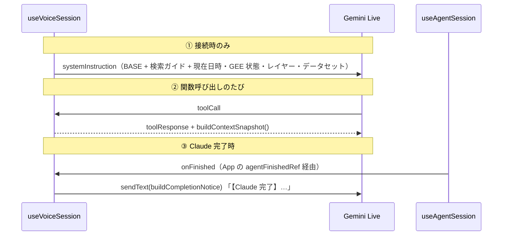
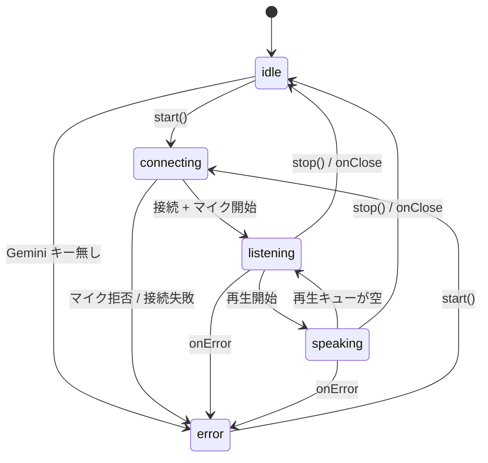

# Gemini Live API 技術解説（引き継ぎ向け）

この文書は、音声相談機能（Gemini Live API）を引き継ぐエンジニア向けの詳細解説です。
全体像は [`architecture.md`](architecture.md) の §7 と構成図
（[architecture-api-flow.jpg](architecture-api-flow.jpg)）を先に見てください。ここでは「コードが何をしているか」と
「なぜそうしているか」、および「触るときにハマる所」を扱います。

> **表記について**
> この文書には 2 種類の記述があります。
> - **コードの事実**: リポジトリのコードを読んで確認した挙動です。
> - **API の仕様**: Gemini Live API 側の挙動です。コード中のコメントが根拠のものは「（実装時のコメントより・現行モデルでは未検証）」と付けています。
>   既定モデルが `gemini-3.8-live` に上がった後は再検証していません。API の仕様は必ず公式ドキュメント
>   （https://ai.google.dev/gemini-api/docs/live ）で確認してください。

---

## 1. 役割と境界

- Gemini Live は Claude とは別系統の **第 2 の LLM 経路** です。ユーザーと音声で会話し、**Claude への指示文を作って実行を依頼する**だけを担当します。
- Gemini に渡す関数は **`run_prompt` と `capture_map` の 2 つだけ**です。GEE / PortWatch / 地図のツールは渡しません。
  - 理由 1: 分析の実行経路を Claude の 1 本に保つためです。ログ・会話履歴・自己修正ループ（`agent/runtime.js`）はこの経路にしかありません。
  - （推測）Gemini の system instruction とツール定義を小さく保ち、音声の応答を軽くする狙いもあると考えられます。コード上の明記はありません。
- 数値の根拠は常に Claude の結果（`【Claude 完了】` 通知）です。Google 検索グラウンディングを有効にしても、検索結果は指示文を具体化するためだけに使います（system instruction で指示しています）。

---

## 2. ファイル構成

| ファイル | 種別 | 役割 |
|---|---|---|
| `src/voice/gemini-live-client.js` | ブラウザ | `@google/genai` の `live.connect` を包む**唯一の場所**。受信メッセージを用途別コールバックへ振り分け（`routeMessage`）、送信 API（`sendAudio / sendImage / sendText / sendAudioStreamEnd / sendToolResponses / close`）を返す |
| `src/voice/voice-tools.js` | 純関数 | 関数宣言 `VOICE_FUNCTION_DECLARATIONS` と、`toolCall` を実装へ振り分ける `dispatchToolCall` / `dispatchFunctionCall` |
| `src/voice/voice-instruction.js` | 純関数 | system instruction（`buildVoiceInstruction`）、ツール応答に同梱する状況スナップショット（`buildContextSnapshot`）、Claude 完了通知文（`buildCompletionNotice`）、グラウンディングのログ整形（`describeGrounding`） |
| `src/voice/voice-options.js` | 純関数 | 既定モデル名・声の一覧（`VOICE_OPTIONS`）と `normalizeVoiceName`。**`@google/genai` に依存しない**（§8 参照） |
| `src/voice/audio-capture.js` | ブラウザ | `getUserMedia` → AudioWorklet → PCM16 base64 のチャンクを `onChunk` に流す。`setMuted` / `stop` を返す |
| `src/voice/pcm-worklet.js` | Worklet | `AudioWorkletProcessor`。入力 Float32 をコピーして `postMessage` するだけ（import 不可のスコープ） |
| `src/voice/audio-player.js` | ブラウザ | 受信した 24kHz PCM を途切れなく再生するキュー。割り込み時は `flush()` |
| `src/voice/pcm.js` | 純関数 | Float32 ⇄ Int16 ⇄ little-endian base64 の変換 |
| `src/voice/gemini-test.js` | 純関数（fetch 注入） | 接続テスト。`GET /v1beta/models` でキーの有効性とモデル名の有無を確認（課金なし） |
| `src/hooks/useVoiceSession.js` | フック | 上記を結線。状態機械・ツール実装・ミュート・完了通知 |
| `src/utils/capture-map.js` | ブラウザ | MapLibre の canvas から JPEG base64 を取る（`capture_map` の実装） |
| `src/components/VoiceButton.jsx` | UI | 開始/停止・ミュート・状態・書き起こし・エラーの表示だけ |
| `src/components/ApiSettings.jsx` | UI | Gemini キー・モデル名・声・検索トグル・接続テスト |

設定は `src/data/settings.js` の localStorage キーに保存します。

| キー | 内容 | 既定 |
|---|---|---|
| `gee-agent.geminiApiKey` | Gemini API キー | 空（空だと音声ボタンが無効になる） |
| `gee-agent.voiceModel` | Live モデル名（自由入力） | `gemini-3.8-live` |
| `gee-agent.voiceName` | prebuilt voice 名 | `Kore` |
| `gee-agent.voiceSearch` | Google 検索グラウンディング（`'1'` で有効） | 無効 |

> ⚠ `DEFAULT_VOICE_MODEL` / `DEFAULT_VOICE_NAME` は `src/data/settings.js` と `src/voice/voice-options.js` に**それぞれ独立して定義されています**（再 export ではありません）。
> 既定値を変えるときは両方を更新してください。実際に接続で使われるのは、設定画面の値（= `settings.js` 側の既定）です。

テスト（`node --test`）は純関数だけを対象にしています。

| テスト | 対象 |
|---|---|
| `test/voice-pcm.test.js` | PCM 量子化・クリップ・LE 往復・長いチャンクの base64 化 |
| `test/voice-tools.test.js` | 公開関数が 2 つだけであること、`run_prompt` の宣言、dispatch のエラー形 |
| `test/voice-instruction.test.js` | instruction の内容、レイヤー一覧、完了通知の整形、検索ガイドとグラウンディングの整形 |
| `test/gemini-live-tools.test.js` | `buildLiveTools`（検索あり/なし）、`normalizeVoiceName` |
| `test/gemini-test.test.js` | 接続テスト（成功・モデル有無・認証エラー・空キー） |

マイク・再生・WebSocket・地図キャプチャの自動テストはありません。`npm run dev` で手動確認します（§11）。

---

## 3. 接続設定（`connectGeminiLive`）

`useVoiceSession.start()` は `gemini-live-client.js` を**動的 import** してから `connectGeminiLive()` を呼びます。
`ai.live.connect` に渡す `config` の各項目は次のとおりです。

| 項目 | 値 | 理由 |
|---|---|---|
| `responseModalities` | `[Modality.AUDIO]` | 応答は音声のみ。画面の字幕は書き起こしで得る |
| `systemInstruction` | `buildVoiceInstruction(...)` | 接続時点のレイヤー・データセット・GEE 状態・現在日時を含む（§6） |
| `tools` | `buildLiveTools({ enableSearch })` | 検索 ON なら `[{ googleSearch: {} }, { functionDeclarations }]`、OFF なら関数宣言のみ |
| `speechConfig.voiceConfig.prebuiltVoiceConfig.voiceName` | `normalizeVoiceName(voiceName)` | 一覧にない名前は `Kore` にフォールバックする |
| `outputAudioTranscription` | `{}` | Gemini の発話の書き起こし → `VoiceButton` の字幕 |
| `inputAudioTranscription` | `{}` | ユーザー発話の書き起こし。**受信はしているが、フックでは未使用**（§5） |
| `mediaResolution` | `'MEDIA_RESOLUTION_MEDIUM'` | 地図スクショの文字が読める程度の解像度にする |
| `contextWindowCompression` | `{ slidingWindow: {} }` | 履歴を圧縮してセッション上限で切れにくくする。上限は「音声のみ 15 分 / 音声+動画 2 分」（実装時のコメントより・現行モデルでは未検証） |

**送信 API の使い分け（コードの事実）**

| メソッド | 中身 | 用途 |
|---|---|---|
| `sendAudio(base64, rate)` | `sendRealtimeInput({ audio: { data, mimeType: 'audio/pcm;rate=<rate>' } })` | マイク音声。`rate` は**実際の AudioContext のサンプルレート**を渡す |
| `sendImage(base64)` | `sendRealtimeInput({ video: { data, mimeType: 'image/jpeg' } })` | 地図スクショ（動画フレーム扱い） |
| `sendText(text)` | `sendRealtimeInput({ text })` | Claude 完了通知。`sendClientContent` ではなく realtime input を使う。理由は「3.1 系は会話中の `sendClientContent` 非対応」（実装時のコメントより・現行モデルでは未検証） |
| `sendAudioStreamEnd()` | `sendRealtimeInput({ audioStreamEnd: true })` | マイク停止・ミュート時に、サーバー側の音声バッファを確定させる |
| `sendToolResponses(responses)` | `sendToolResponse({ functionResponses })` | 関数呼び出しへの応答 |

---

## 4. 音声パイプライン

### 4.1 上り（マイク → Gemini）

- `AudioContext` は **16kHz を要求**して開きます（`TARGET_SAMPLE_RATE`）。ブラウザが従わないこともあるため、
  実際の `context.sampleRate` を返し、それを mimeType の `rate=` に入れます。**リサンプリングはしていません。**
- `echoCancellation: true` は、スピーカーから出る Gemini の声をマイクで拾い直さないための設定です（コードコメントより）。
- ワークレットの出力は**ゲイン 0 のノード経由で `destination` に繋いでいます**。ブラウザによっては destination まで繋がないと `process` が回らないためです。ゲイン 0 なのでハウリングは起きません。
- `pcm-worklet.js` は、入力バッファが次の呼び出しで再利用されるため**コピーしてから transfer** します。`process` は停止まで `true` を返し続けます。
- 量子化は負側 ×32768・正側 ×32767 の対称クリップです。base64 化は `DataView` で little-endian を明示し、`String.fromCharCode` の引数上限を避けるため 32KB ごとに分割します。

### 4.2 下り（Gemini → スピーカー）

- 音声は `serverContent.modelTurn.parts[].inlineData.data`（base64 PCM16・24kHz）で届きます。
- `audio-player.js` はチャンクごとに `AudioBuffer` を作り、**前のチャンクの終端（`nextStartTime`）に繋げて `start(startAt)` で予約**します。
  最初のチャンクは `currentTime + SCHEDULE_AHEAD (0.08s)` から鳴らします。この余裕を詰めすぎると先頭が欠けます。
- 再生中のソースを `Set` で管理し、`onStateChange(playing)` でフックの状態を `speaking` ⇄ `listening` に切り替えます。
- `serverContent.interrupted`（ユーザーが割り込んだとき）では `flush()` が予約済みの全ソースを止め、`nextStartTime` をリセットします。字幕もクリアします。
- 出力用の `AudioContext` は最初の `enqueue` で遅延作成します。`suspended` なら `resume()` します。

---

## 5. 受信メッセージのルーティング

`gemini-live-client.js` の `routeMessage` が振り分けます。**フックで実際に結線しているか**に注意してください。

| サーバーメッセージ | コールバック | `useVoiceSession` での扱い |
|---|---|---|
| `setupComplete` | `onReady` | **未結線** |
| （WebSocket open） | `onOpen` | **未結線** |
| `serverContent.modelTurn.parts[].inlineData` | `onAudio` | `player.enqueue` |
| `serverContent.modelTurn.parts[].text` | `onText` | **未結線**（AUDIO モダリティなので通常は来ない想定） |
| `serverContent.outputTranscription` | `onOutputTranscript` | 字幕に追記 |
| `serverContent.inputTranscription` | `onInputTranscript` | **未結線**（ユーザー発話の字幕を出したいならここ） |
| `serverContent.interrupted` | `onInterrupted` | `player.flush()` と字幕クリア |
| `serverContent.turnComplete` | `onTurnComplete` | 字幕を trim |
| `serverContent.groundingMetadata` | `onGrounding` | `describeGrounding` で `🔎 音声: 検索: … 出典: …` をログ出力 |
| `toolCall` | `onToolCall` | `handleToolCall`（§6） |
| `toolCallCancellation` | `onToolCancel` | **未結線**（§10） |
| `goAway` | `onGoAway` | ログに「まもなく終了（残り …）」を出すだけ。再接続はしない |
| WebSocket error | `onError` | `fail()` → エラー表示 + teardown |
| WebSocket close | `onClose` | `teardown(reason)` |

---

## 6. 関数呼び出しとコンテキストの渡し方

### 6.1 公開関数

| 関数 | 引数 | 実装（`useVoiceSession.handleToolCall`） |
|---|---|---|
| `run_prompt` | `text`（必須） | 空なら例外。`isAgentRunning` なら `{ok:false, busy:true}`。それ以外は `setChatInput(text)` のあと `runPrompt(text)`（App の `runPromptFromVoice` → チャットタブを開いて `useAgentSession.handleSubmit`）を呼ぶ。`false` が返れば失敗（**Claude の** API キー未設定 / 実行中） |
| `capture_map` | `reason`（任意） | `captureMapImage()` → **先に `sendImage` で画像を送り、その後でツール応答を返す** |

- ディスパッチは**逐次**です（`dispatchToolCall` が `for … await`）。理由は「`gemini-3.1-flash-live-preview` は非同期 function calling 非対応」（実装時のコメントより・現行モデルでは未検証）です。
- ハンドラ内で投げた例外は `dispatchFunctionCall` が捕まえ、`{ ok:false, error }` に変換して返します（`agent/runtime.js` と同じ方針）。未対応の関数名や `text` の欠落もこの形になります。
- ハンドラが明示的に返す応答（成功・busy・`runPrompt` が `false`）には `buildContextSnapshot()` を同梱します（`gee_logged_in / claude_running / layers / datasets`）。**例外経由のエラー応答（空の text、未対応関数、`captureMapImage` の失敗など）にはスナップショットが付きません。**
- `capture_map` の順序を逆にすると、モデルが画像を見ないまま話し始めます（コードコメントより）。
- `captureMapImage` は描画の落ち着きを待つため 600ms 待ちます。幅 1024px を超えると縮小し、JPEG（品質 0.75）にします。
  `toDataURL` で読むため `MapView.jsx` の `<Map preserveDrawingBuffer>` が必須です。interleaved モードなので deck.gl のレイヤーも同じ canvas に写ります。

### 6.2 コンテキストは 3 つの経路で渡す

1. **system instruction（接続時のみ）**: 会話中に変わったレイヤーなどは反映されません。会話中の変化を `sendText` で逐一送ることは**意図的にしていません**。
2. **ツール応答のスナップショット**: 最新の状況は Gemini が関数を呼んだときにだけ届きます。
3. **完了通知の `sendText`**: Gemini に読み上げさせたいので、これだけはテキストで送ります。本文は Markdown 記号を落として 300 文字に切り詰め、追加レイヤー名とチャート数を添えます。
   - `useAgentSession` と `useVoiceSession` は依存順の都合で直接参照できません。そのため、App が `agentFinishedRef` に `notifyAgentFinished` を入れて中継しています。
   - `notifyAgentFinished` はセッション中でなければ何もしません。テキスト入力で Claude を動かした場合も、音声セッション中なら読み上げます。

`contextRef`（`useEffect` で最新の layers / datasets / geeState / isAgentRunning を保持）は、②の生成と `run_prompt` の busy 判定に使います。

### 6.3 ⚠ `run_prompt` の応答タイミング（コードリーディングによる指摘・実機未確認）

`useAgentSession.handleSubmit` は **Claude の実行が完了するまで resolve しません**（`runAgent` を await し、最後に `return true`）。
そのため、コード上の実際の順序は次のとおりです。

1. Gemini が `run_prompt` を呼ぶ
2. `handleSubmit` が Claude を実行する（数十秒〜数分）
3. 完了時に `onFinished` → `sendText(【Claude 完了】…)` が**先に**送られる
4. その後で `run_prompt` のツール応答（`note: '…実行を開始しました…'`）が返る

影響:
- ツール応答の文言「実行を開始しました」は、実際には完了後に届きます。スナップショットの `claude_running` は、`contextRef` の更新（effect）と応答生成のどちらが先かによって `true` / `false` のどちらにもなり得ます（タイミング依存）。
- 関数呼び出しが応答待ちのあいだ、Gemini がどう振る舞うかは**未検証の API 仕様**です。会話を続けられるのか、ブロックされるのかはモデルに依存する可能性があります。
- busy 判定（`contextRef.current.isAgentRunning`）が実際に効くのは、主にテキスト入力で Claude が既に動いているときです。
- 1 つの `toolCall` に `run_prompt` が 2 つ入った場合、逐次ディスパッチなので 2 つ目は 1 つ目の完了後に実行されます。

### 6.4 ⚠ `run_prompt` が呼ぶ `handleSubmit` は接続時点のもの（コードリーディングによる指摘・実機未確認）

Live セッションのコールバック（`onToolCall` など）は、`start()` の中で**接続時に一度だけ**束縛されます。
そのため、`handleToolCall` → `runPrompt`（`runPromptFromVoice`）→ `handleSubmit` の連鎖は、**音声セッションを開始したレンダー時点のクロージャに固定**されます。

影響:
- 音声経由で実行した Claude の揮発 system ブロック（`buildSystemBlocks`）には、**セッション開始時点の** `layers` / `datasets` / `geeState` が入ります。セッション中に追加したレイヤーや GEE ログインは Claude に伝わりません。地図の表示範囲（`getMapView()`）や会話履歴（`conversationStore`）は呼び出し時に読むので最新です。
- `handleSubmit` 内の `isRunning` ガードも固定されます。**Claude の実行中に音声セッションを開始すると、そのセッション中の `run_prompt` はすべて `false`（失敗）になります。**
- busy 判定のうち `contextRef.current.isAgentRunning` 側は最新値なので、そちらは正しく効きます。

改修案（6.3 と合わせて）:
- 最新の `handleSubmit` を ref に入れ（`handleSubmitRef.current = handleSubmit`）、`runPromptFromVoice` からは ref 経由で呼ぶ。`handleToolCall` も同様に ref 経由にすると、束縛時点の問題が無くなります。
- `handleSubmit` の Promise は await せず、開始できたかどうかだけを即座に返す。判定に使う `isRunning` も ref から読む必要があります（state をクロージャで読むと同じく古くなります）。こうすると、ツール応答が先・完了通知が後という本来意図した順序になります。

---

## 7. 状態機械とライフサイクル

- **`start()` の順序**: プレイヤー作成 → `import('../voice/gemini-live-client')` → `connectGeminiLive` → `startAudioCapture` → `listening`。
  マイク権限エラー（`NotAllowedError` / `Permission`）は日本語のメッセージに置き換えます。
- **`teardown(reason)` の順序**: マイク停止 → `audioStreamEnd` → セッション `close` → プレイヤー `close`。`stoppingRef` で再入を防ぎます。
  `error` 状態は残し（エラー表示のため）、それ以外は `idle` に戻します。アンマウント時にも呼びます。
- **`fail(message)`**: エラーを表示し、ログに `✗ 音声:` を出して teardown します。
- **ミュート（`toggleMute`）**: セッションは切りません。`track.enabled = false` に加え、ワークレットからのチャンクも破棄します。
  ミュートにした瞬間に `audioStreamEnd` を送るのは、言いかけの音声が残ってサーバーが発話の区切りを待ち続けないようにするためです。
  ミュート中も、Gemini の発話・関数呼び出し・完了通知は続きます。
- **経過時間**: `listening` / `speaking` のあいだ 1 秒ごとに加算し、`VoiceButton` に `m:ss` で表示します。
- 声・モデル・検索の設定変更は、**次の `start()` から**反映されます（接続時の config に焼き込むため）。

---

## 8. ビルド・CSP のハマりどころ

| 症状 | 原因と対処 |
|---|---|
| 本番だけ `Unable to load a worklet's module.` | worklet のモジュール取得は `script-src` の対象です。Blob URL や data: URL にすると CSP で弾かれます。`new URL('./pcm-worklet.js', import.meta.url)` で**同一オリジンの実ファイル**として配信し、`vite.config.js` の `assetsInlineLimit` でこのファイルだけインライン化を無効にしています。**ここは変えないこと** |
| 本番だけ Gemini に接続できない | CSP の `connect-src` に `https://generativelanguage.googleapis.com` と `wss://generativelanguage.googleapis.com` の**両方**が必要です（REST の接続テストと WebSocket）。dev サーバーは CSP を適用しないので、本番ビルド（`npm run build && npm run preview`）で確認してください |
| `@google/genai` が初期チャンクに入る | UI（`ApiSettings.jsx`）が `gemini-live-client.js` を直接 import すると、動的 import が効かなくなります。UI が使う定数は `voice-options.js` に分離してあるので、**UI からは `voice-options.js` だけを import する**こと |
| `capture_map` の画像が真っ黒 | `<Map preserveDrawingBuffer>` が外れているか、タイルの読み込み前に撮っています。instruction 側でも「暗い場合は推測せず尋ねる」と指示しています |
| マイクが使えない | `getUserMedia` は HTTPS か localhost が必要です。AudioWorklet 非対応のブラウザでもエラーになります |

---

## 9. セキュリティ

- Gemini API キーはユーザーのブラウザ（localStorage）にだけ置き、**ブラウザから直接 WebSocket 接続**します。
  バックエンドが無いため ephemeral token を発行できず、Claude のキーと同じ姿勢を取っています。
  設定画面では「専用キーを作り、利用上限を設定する」ことを案内しています。
- 接続テスト（`gemini-test.js`）は、キーを**URL のクエリ**（`?key=`）に載せて `GET /v1beta/models` を呼びます。ブラウザの履歴には残りませんが、DevTools のネットワークログには出ます。
- Google 検索グラウンディングは**別課金**です（無料枠を超えると検索ごとに課金）。既定は OFF です。
- Gemini は UI 操作しかできません。ただし `run_prompt` は**確認なしで Claude を実行**します。Claude 側のツール（EE 実行など）の安全策はそちらに依存します。

---

## 10. 未実装・既知の制約

- **再接続・セッション再開（session resumption）なし**。`goAway` はログを出すだけです。切断されたら、ユーザーがもう一度ボタンを押します。
- **`toolCallCancellation` 未対応**。割り込みで取り消された呼び出しにもツール応答を返してしまう可能性があります（`run_prompt` は既に Claude を起動済みです）。
- **`run_prompt` のツール応答が Claude 完了後になる**（§6.3、コードリーディングによる指摘）。
- **音声経由の `handleSubmit` が接続時点のクロージャに固定される**（§6.4、コードリーディングによる指摘）。
- **会話中のコンテキスト更新は関数呼び出し時のみ**。ユーザーが手でレイヤーを追加しても、Gemini は次に関数を呼ぶまで知りません。
- **ユーザー発話の書き起こしは画面に出していない**（`onInputTranscript` 未結線）。
- **リサンプリングなし**。ブラウザが 16kHz を受け付けない場合は実レートをそのまま申告します。サーバー側が受け付けるかは API の仕様次第です。
- 音声 I/O・WebSocket・キャプチャの**自動テストなし**。
- 既定値の二重定義（§2 の注記）。

---

## 11. 改修レシピと動作確認

### 関数を追加する
1. `voice-tools.js` の `VOICE_FUNCTION_DECLARATIONS` に宣言を追加し、名前の定数を export します（型は `'OBJECT'` / `'STRING'` などの大文字表記）。
2. `useVoiceSession.handleToolCall` の handlers に実装を追加します。応答には `...snapshot()` を含め、失敗は `throw` か `{ok:false, error}` で返します。
3. `voice-instruction.js` の `BASE` に使いどころを 1 行足します。
4. `test/voice-tools.test.js` の「公開するのは 2 つだけ」テストを更新します。
5. **アプリのデータソースのツールを Gemini に直接渡すのは方針違反**です（§1）。必要なら `run_prompt` 経由で Claude に任せてください。

### モデル・声を変える
- 既定モデル: `src/data/settings.js` と `src/voice/voice-options.js` の両方を変えます。設定画面のモデル名は自由入力なので、利用者側でも変更できます。接続テストで「一覧にない」と出たら、Live 対応モデルの候補がメッセージに表示されます。
- 声: `VOICE_OPTIONS` に `[名前, 説明]` を追加します。一覧にない名前は `Kore` にフォールバックします。

### instruction を変える
- `voice-instruction.js` の `BASE` / `SEARCH_GUIDE` を編集し、`test/voice-instruction.test.js` を通します。
- 音声なので「短く・1 度に 1 問」を崩さないようにします。完了通知の `【Claude 完了】` という接頭辞は instruction と通知文の両方に出てくるので、変えるときは両方を揃えます。

### 手動確認チェックリスト（`npm run dev`、本番相当は `npm run build && npm run preview`）
1. ⚙ 設定で Gemini キーを入れ、「接続テスト」で `接続 OK` が出る。
2. 「音声で相談」 → ログに `🎙 音声セッション開始（<model>, 声: …）` が出て、状態が「聞き取り中」になる。
3. 話しかけると応答が再生され、字幕が出る。途中で割り込むと再生が止まる。
4. 「この辺を見て」など → ログに `▶ 音声: capture_map` → `✓ 音声: capture_map（W×H）` が出る。
5. 具体的な依頼をすると、チャットに指示文が入って Claude が走る。完了すると `🎙 音声: Claude 完了を通知` が出て結果が読み上げられる。コードから予想される順序では、**その後に** `✓ 音声: run_prompt → 実行開始` が出る（このログはツール応答の直前に出るため。§6.3）。実機で順序を確かめておくと §6.3 の裏付けになる。
6. ミュートにすると `🔇` が出てマイク入力が止まる。Gemini の読み上げは続く。
7. 検索 ON で最近の出来事を聞くと、`🔎 音声: 検索: …` が出る。
8. 本番ビルドで 2・5 を確認し、CSP 違反（worklet / wss）が出ないことを見る。
